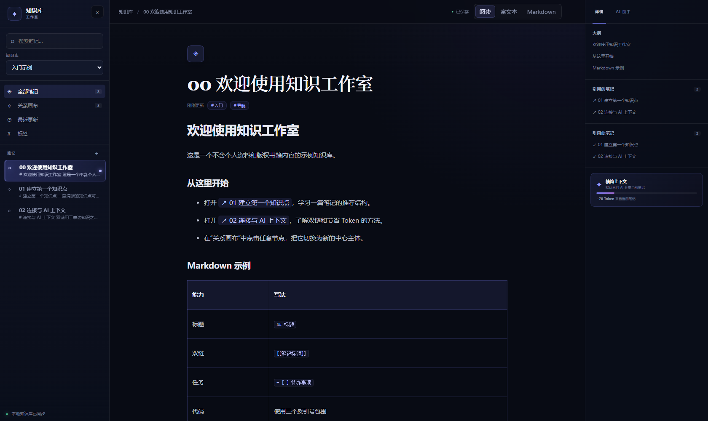
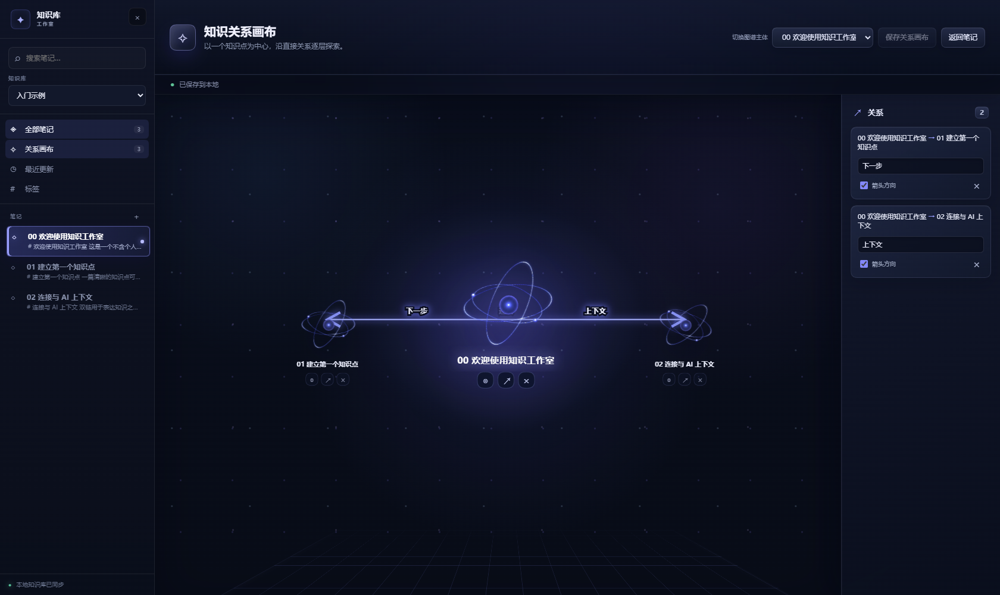

# DeepSeek Harness Knowledge Studio

一个可下载、可回退的 DeepSeek Harness 知识库插件发行包，为 Harness 增加独立的 Obsidian 风格知识工作区。

> **非官方发行封装。** 本仓库不是 DeepSeek 官方发布，不包含 DeepSeek Harness 本体，也不包含完整 TypeScript 源码。发布包由六个保留原始 MIT 许可和元数据的编译插件包组成。

## 功能

- 双链 Markdown 笔记与反向链接
- 以当前知识点为主体的关系图谱，点击节点可切换主体
- 独立知识点编辑、标签、搜索与大纲
- 图片、代码块、表格和 Wiki 链接
- 每篇笔记独立的 Excalidraw 画布
- 聚焦当前笔记的 AI 助手，发送前显示上下文与 Token 估算
- 本地文件持久化；卸载插件不会删除知识库

## 界面预览





## 兼容性

- Windows 10/11 x64
- DeepSeek Harness `0.1.2-rc.1`
- Knowledge Studio `0.1.0-rc.5`
- PowerShell 5.1 或更高版本

其他 Harness 版本必须显式使用 `-AllowUnsupportedHarnessVersion`，且不保证兼容。

## 安装

1. 从 [v0.1.0-rc.5 发布页](https://github.com/aixuname/deepseek-harness-knowledge-studio/releases/tag/v0.1.0-rc.5) 下载 `knowledge-studio-windows-x64-v0.1.0-rc.5.zip`。
2. 解压 ZIP，并完全退出 DeepSeek Harness。
3. 双击 `install.cmd`。
4. 重启 Harness，在侧边栏进入“知识库”。

安装器会自动完成：

- 检测 Harness 安装目录和 `DSH_HOME`
- 校验六个插件包的 SHA-256
- 在修改前备份 `package.json`、锁文件和用户补丁
- 通过 Harness 自带的 `dsh plugin` 安装插件
- 写入可移植的知识库路径覆盖，不使用开发者电脑上的固定路径
- 安装一个无版权内容的“入门示例”知识库
- 运行 `dsh plugin --profile web doctor` 健康检查

如果 Harness 不在常见位置，可在 PowerShell 中指定：

```powershell
.\install.ps1 -HarnessRoot 'D:\Apps\DeepSeek Harness'
```

也可以指定数据目录：

```powershell
.\install.ps1 `
  -HarnessRoot 'D:\Apps\DeepSeek Harness' `
  -DshHome 'D:\DeepSeekHarnessData\dsh-home' `
  -KnowledgeRoot 'D:\DeepSeekHarnessData\knowledge'
```

## 卸载

完全退出 Harness 后双击 `uninstall.cmd`。卸载器只移除六个插件依赖和安装器写入的配置块，**不会删除任何笔记、图片、画布或备份**。

## 安全与隐私

- 插件不附带模型密钥。
- AI 助手只构造当前笔记、问题以及少量明确相关笔记的有界上下文。
- 安装器不上传知识库，不修改 Harness 本体，不覆盖其他插件。
- 发布包不包含作者的个人知识库、PDF、会话、令牌、缓存或绝对路径配置。

## 包组成

| 包 | 作用 |
| --- | --- |
| `@deepseek-ai/dsh-knowledge` | 知识领域模型和远程接口 |
| `@deepseek-ai/dsh-knowledge-local` | 本地 Markdown 知识库与原子写入 |
| `@deepseek-ai/dsh-knowledge-ai` | 受 Token 预算约束的 AI 协作 |
| `@deepseek-ai/dsh-client-ui-surface` | 顶层持久页面容器 |
| `@deepseek-ai/dsh-client-ui-knowledge` | 中文知识库、编辑器、画布和关系图谱界面 |
| `@deepseek-ai/dsh-knowledge-studio` | 可安装的 Harness 组合包 |

## 开发与验证

仓库保存的是发行封装，不是上游源码镜像。验证发布材料：

```powershell
powershell -NoProfile -ExecutionPolicy Bypass -File .\scripts\verify-release.ps1
```

构建 GitHub Release ZIP：

```powershell
powershell -NoProfile -ExecutionPolicy Bypass -File .\scripts\build-release.ps1
```

## 许可

安装器、文档和示例库使用 [MIT](LICENSE)。六个插件包保留 DeepSeek MIT 许可，详见 [NOTICE](NOTICE.md) 与 [LICENSES](LICENSES/DeepSeek-Knowledge-Studio-MIT.txt)。

